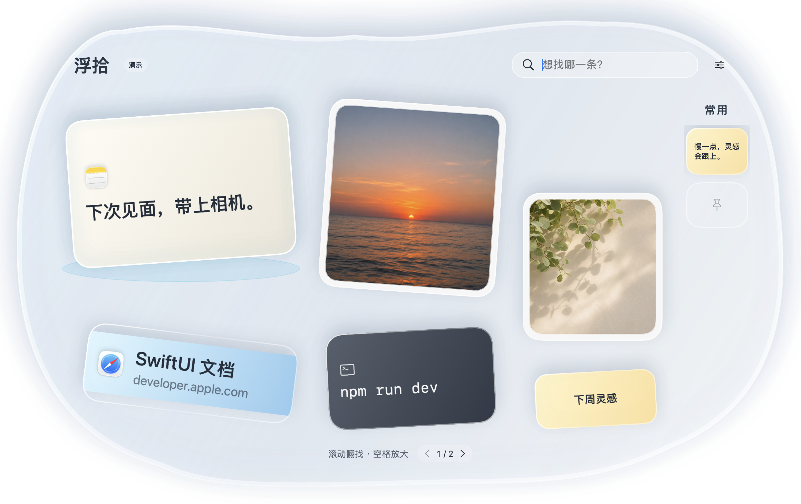

<p align="center"></p>

# 浮拾 · Fushi

一个免费、开源的原生 macOS 剪贴板工具。复制过的文字、图片和链接，以不同形状的小物件留在一个轻盈的浮池里。

基于 [Maccy 2.8.0](https://github.com/p0deje/Maccy) 二次开发，保留 MIT 许可证与原作者版权。浮拾是独立的二开项目。

> 当前为预览版。建议先在自己的工作环境试用；兼容性和分发状态见下文。



## 可以做什么

- 记录本机复制的文字、图片、链接和文件，搜索和翻页查找。
- 点击条目，粘贴到呼出浮拾前定位的输入框；设置里可以关闭，改为只复制。
- 右键「仅复制」或使用 ⌘C，保留手动粘贴的选择。
- 把条目拖进支持原生拖放的输入框或编辑器；图片与文件需目标应用支持接收。
- 拖到右侧常用区固定，空格查看长文本和图片，Esc 收起。
- 使用包内新图标的轻提示；反馈不把剪贴板原文放进通知中心。

## 使用

1. 打开浮拾，先复制一些内容。
2. 在目标应用中点好输入位置，按 **Control + Option + 空格** 呼出浮拾。
3. 单击内容，或直接拖进目标输入框。

「设置 → 点击条目后自动粘贴」默认开启。自动粘贴需要在 **系统设置 → 隐私与安全性 → 辅助功能** 中允许浮拾；设置页提供入口。关闭开关后，点击条目只复制，再由你按 ⌘V。

浮拾只投递粘贴快捷键，不按回车、不点击发送按钮。权限不足、目标不是可编辑输入框、焦点或剪贴板发生变化时，保留复制结果并提示，避免粘到别处。部分编辑器未暴露辅助功能接口时，可用拖放或手动粘贴。

## 下载与安装

[下载预览版](https://github.com/carey314/macPaste/releases) · Apple Silicon / ARM64。解压后将「浮拾.app」放进应用程序文件夹，再打开使用。

预览包尚未经过 Apple 公证，macOS 可能阻止直接打开；也可以按下面步骤在自己的 Mac 上从源码构建。

## 从源码构建

工程最低部署目标为 macOS 14；目前的本机验证环境为 macOS 26.4、Apple Silicon、Xcode 26.5。macOS 14/15 和 Intel 仍需设备验证。需要完整 Xcode 及能解析现有 SwiftPM 依赖的 Swift 工具链。

```sh
git clone https://github.com/carey314/macPaste.git
cd macPaste
xcodebuild build -project Fushi.xcodeproj -scheme Fushi \
  -configuration Release -destination 'platform=macOS' \
  -derivedDataPath build CODE_SIGNING_ALLOWED=NO
codesign --force --deep --sign - --timestamp=none \
  'build/Build/Products/Release/浮拾.app'
open 'build/Build/Products/Release/浮拾.app'
```

也可以在 Xcode 打开 `Fushi.xcodeproj`，选择 `Fushi` Scheme 运行；默认使用本机临时签名，不依赖维护者的开发团队。应用文件名为「浮拾.app」，模块和可执行文件名为 `Fushi`。

当前预览包使用临时签名，**没有 Apple 公证**，具体兼容范围与限制会在对应 Release 中说明。临时签名可能在重新构建后需要重新授予辅助功能权限。这里的源码开放和免费许可不等于已完成面向所有 Mac 的安装验证。

## 数据与权限

剪贴板历史保存在本机应用支持目录的 `ShiguangPool/Storage.sqlite`，当前 GitHub 构建为非沙箱桌面工具，实际目录为用户应用支持目录。浮拾与原版 Maccy 使用不同应用标识、偏好和数据库；不会自动迁移旧历史。

运行浮拾不需要 AI 账号、API Key、订阅或自建服务器。自动更新已关闭。辅助功能用于识别原目标输入控件并向对应进程投递粘贴；不读取输入框原文。完整说明见 [PRIVACY.md](PRIVACY.md)。

## 验证与反馈

核心策略测试覆盖开关、仅复制、隔离演示、权限、只读输入、焦点变化和剪贴板竞态。可以运行：

```sh
xcodebuild test -project Fushi.xcodeproj -scheme Fushi \
  -destination 'platform=macOS' -derivedDataPath build \
  -only-testing:FushiTests/PoolLayoutTests \
  -only-testing:FushiTests/PoolExperienceTests \
  -only-testing:FushiTests/PoolInputPolicyTests \
  -only-testing:FushiTests/PoolPastePolicyTests \
  -skip-testing:FushiUITests -collect-test-diagnostics never \
  CODE_SIGNING_ALLOWED=YES CODE_SIGN_IDENTITY=- \
  CODE_SIGN_STYLE=Manual DEVELOPMENT_TEAM=
```

`FushiUITests` 为可选的开发者界面测试入口，依赖本机 Xcode 签名配置；当前版本没有完成所有机型、编辑器和输入框的兼容验收。演示截图使用内存合成数据和专用剪贴板，不展示真实历史。`tools/InputFixture.swift` 提供独立原生输入框供拖放/粘贴测试。

提交 Issue 时请注明 macOS 版本、芯片、构建方式和复现步骤。请不要上传剪贴板数据库、密码或含私人内容的截图。

## 开源来源

- 原项目：[Maccy](https://github.com/p0deje/Maccy)，Alex Rodionov；基于 2.8.0 / `f0b571e32e4031d7b91ba811f50d0f33e8e5548b`。
- 复用了剪贴板引擎、历史存储、搜索、快捷键和原生基础设施；浮拾增加了浮池界面、常用区交互、输入目标校验和新的品牌资源。
- MIT 允许使用、修改和再分发；再分发时请保留原版权与许可证。详见 [LICENSE](LICENSE)、[NOTICE.md](NOTICE.md) 和 [第三方许可](ThirdPartyLicenses)。

你可以免费使用与分享，也欢迎改进代码、反馈兼容性问题。
